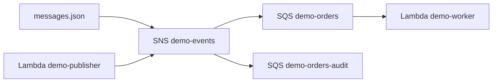

# LocalStack + Terraform

AWS local para probar IAM, Lambda, SQS y SNS. LocalStack es el servidor que imita AWS. Terraform es la receta que crea los recursos dentro de ese servidor.

Al terminar tienes un circuito de pedidos:



1. `terraform/messages.json` tiene cuatro pedidos: `ord-1001`, `ord-1002` creado, `ord-1002` pagado y `ord-1003` cancelado.
2. Terraform los publica en el topic **demo-events**. Un topic avisa a todas las colas suscritas.
3. **demo-orders** recibe el pedido y despierta a **demo-worker**. Esa Lambda lo lee y lo borra, así que esa cola queda vacía.
4. **demo-orders-audit** recibe la misma copia y nadie la lee. Ahí quedan los mensajes para mirarlos.
5. **demo-publisher** manda un quinto pedido, `ord-lambda-1`, para probar una Lambda que escribe en el topic.
6. **demo-orders-dlq** espera mensajes que fallen 3 veces. Empieza vacía.

## Requisitos

- Docker Desktop en marcha.
- AWS CLI (`aws`).
- Python 3. Lo usa el paso que publica los pedidos.
- Terraform 1.5 o más nuevo.

En macOS, Terraform se instala desde el tap de HashiCorp:

```bash
brew tap hashicorp/tap
brew install hashicorp/tap/terraform
terraform version
```

## 1. Token de LocalStack

La imagen actual pide una cuenta, también en el plan Hobby (gratis para uso no comercial).

1. Crea la cuenta en [https://app.localstack.cloud](https://app.localstack.cloud).
2. Copia un Developer Auth Token desde [Auth Tokens](https://app.localstack.cloud/workspace/auth-tokens).
3. En la raíz de este repo:

```bash
cp .env.example .env
```

4. Pega el token en `LOCALSTACK_AUTH_TOKEN`. Ese archivo no se commitea.

## 2. Arrancar LocalStack

Desde la raíz del repo:

```bash
./scripts/up
```

Eso levanta el contenedor `localstack-main`. El gateway queda en `http://localhost:4566`.

Comprueba que está sano:

```bash
docker compose ps
curl -s http://localhost:4566/_localstack/health
```

La Web UI es [https://app.localstack.cloud](https://app.localstack.cloud). Conecta la instancia a `https://localhost.localstack.cloud:4566`. Desde ahí se ven IAM, Lambda, SQS y SNS.

Para pararlo:

```bash
./scripts/down
```

`PERSISTENCE=0` en `.env` significa que al bajar el contenedor se pierde lo que había dentro de LocalStack. Los archivos de Terraform siguen en el disco. Después de un `./scripts/up` hay que volver a hacer `terraform apply` para recrear los recursos.

En este Mac el socket de Docker está en `~/.docker/run/docker.sock`. `scripts/up` exporta `DOCKER_HOST` para que Compose lo encuentre. Hace falta montar ese socket para que Lambda pueda arrancar contenedores.

## 3. Crear los recursos con Terraform

Los `.tf` están en `terraform/`. Hay que ejecutar Terraform **dentro de esa carpeta**. Si lo corres en la raíz del repo, responde `No configuration files` porque ahí no hay archivos `.tf`.

```bash
cd terraform
terraform init
terraform plan
terraform apply
```

- `terraform init` descarga los plugins de AWS y de zip. Se hace una vez, o cuando cambian los providers.
- `terraform plan` muestra lo que crearía. No crea nada.
- `terraform apply` lo crea. Confirma con `yes`.

Al final imprime los ARN de los roles, el ARN del topic y las URLs de las colas.

Para ver los pedidos que quedaron en la cola de auditoría, sigue dentro de `terraform/`:

```bash
../scripts/awslocal sqs receive-message \
  --queue-url "$(terraform output -raw audit_queue_url)" \
  --max-number-of-messages 5 \
  --visibility-timeout 0 \
  --message-attribute-names All
```

`scripts/awslocal` es el AWS CLI apuntando a `http://localhost:4566`, con la clave de prueba `test` y la región `us-east-1`.

## Qué es Terraform en este proyecto

Terraform no es el programa de los pedidos. Es la lista de “quiero este rol, esta cola, esta Lambda”. `terraform apply` lee esa lista y la crea en LocalStack. Anota lo creado en `terraform/terraform.tfstate`. La próxima vez no vuelve a crear lo que ya existe.

No hay nombres de archivo obligatorios. Terraform junta **todos** los `.tf` de la carpeta y los trata como una sola receta. Podrían llamarse de otra forma, o ir todos en un solo archivo. El orden de los archivos no importa. El orden de creación lo marcan las referencias: si una Lambda usa `aws_iam_role.worker.arn`, el rol se crea antes.

| Archivo | Qué hace |
|---|---|
| `versions.tf` | Pide Terraform >= 1.5, el provider AWS 5.x y el provider que hace los zip. |
| `provider.tf` | Apunta IAM, Lambda, SQS, SNS, STS y logs a `http://localhost:4566`. Define la región y la etiqueta `Project = localstack-demo`. |
| `iam.tf` | Crea los tres roles y lo que cada uno puede hacer. |
| `sqs.tf` | Crea las tres colas y el permiso para que SNS les escriba. |
| `sns.tf` | Crea el topic y lo suscribe a las dos colas. |
| `lambda.tf` | Empaqueta `lambda/*.py` y crea las dos funciones y el cable de `demo-orders` hacia `demo-worker`. |
| `messages.tf` | Publica los pedidos de `messages.json` e invoca `demo-publisher`. |
| `outputs.tf` | Imprime ARN y URLs al terminar. No crea recursos. |

`messages.json`, los `.py` y los `.zip` de `build/` no se ejecutan solos. Un `.tf` los lee o los empaqueta.

Orden real del `apply`:

1. Comprime las Lambdas en tu Mac y consulta la cuenta (`000000000000`).
2. Crea la cola fallida, la cola de auditoría, el topic y los roles de las Lambdas.
3. Crea `demo-orders` (necesita la cola fallida) y el rol lector (necesita el número de cuenta).
4. Crea las políticas de los roles y de las colas.
5. Crea las dos Lambdas.
6. Suscribe las colas al topic y conecta `demo-orders` con `demo-worker`.
7. Publica los cuatro pedidos y llama a `demo-publisher` con `ord-lambda-1`.
8. Imprime los outputs.

## Los dos documentos de un rol

Un rol tiene dos textos distintos.

El **Assume Role Policy** dice quién puede ponerse el rol. En `demo-lambda-publisher` dice que el servicio Lambda puede asumirlo (`sts:AssumeRole`). Eso es lo que muestra la Web UI en “Assume Role Policy Document”.

La **política adjunta** dice qué puede hacer después de ponérselo. Está en la pestaña de permisos:

- `demo-lambda-worker`, política `consume-orders`: leer y borrar mensajes de `demo-orders`, y escribir logs.
- `demo-lambda-publisher`, política `publish-events`: publicar solo en `demo-events`, y escribir logs.
- `demo-orders-reader`, política `read-audit`: mirar la cola de auditoría y consultar el topic. No puede publicar ni borrar.

## Código de las Lambdas

- `lambda/worker.py` recibe el evento de SQS, lee el pedido y lo escribe en los logs.
- `lambda/publisher.py` publica en el topic que Terraform le pasa por la variable `TOPIC_ARN`.

Si cambias un `.py` o `messages.json`, otro `terraform apply` desde `terraform/` vuelve a subir la función o a publicar los pedidos.

## Errores frecuentes

**`No configuration files`.** El comando se lanzó fuera de `terraform/`. Entra a esa carpeta y repítelo.

**El contenedor no arranca.** Revisa que Docker Desktop esté abierto y que `LOCALSTACK_AUTH_TOKEN` en `.env` no esté vacío.

**`EntityAlreadyExists` en el apply.** Esos nombres ya existen en LocalStack y Terraform no los tiene en su estado. Con la persistencia apagada, `./scripts/down`, `./scripts/up` y otro `terraform apply` dejan la cuenta limpia y la vuelven a crear.
